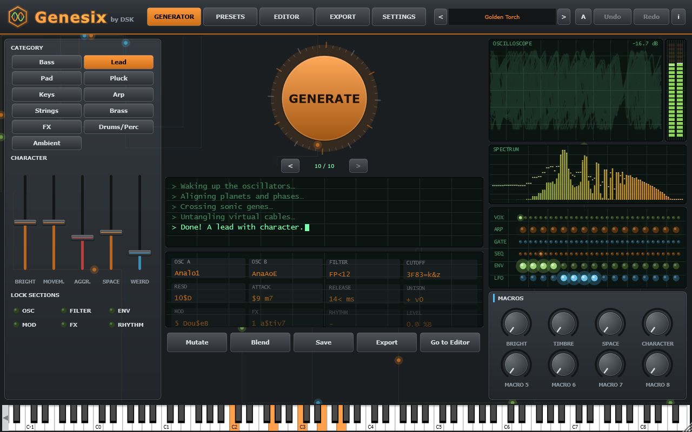
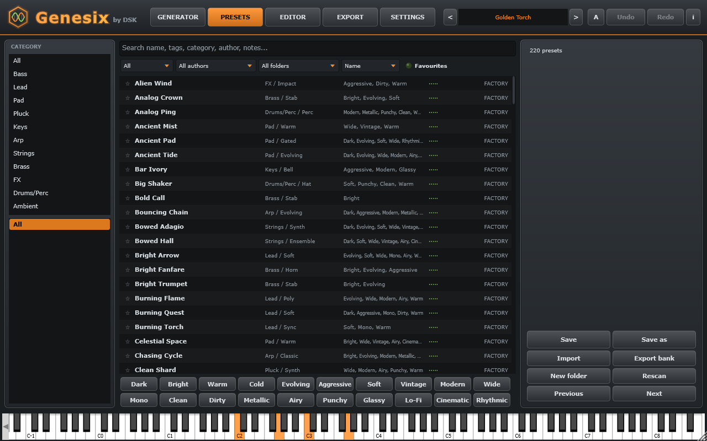
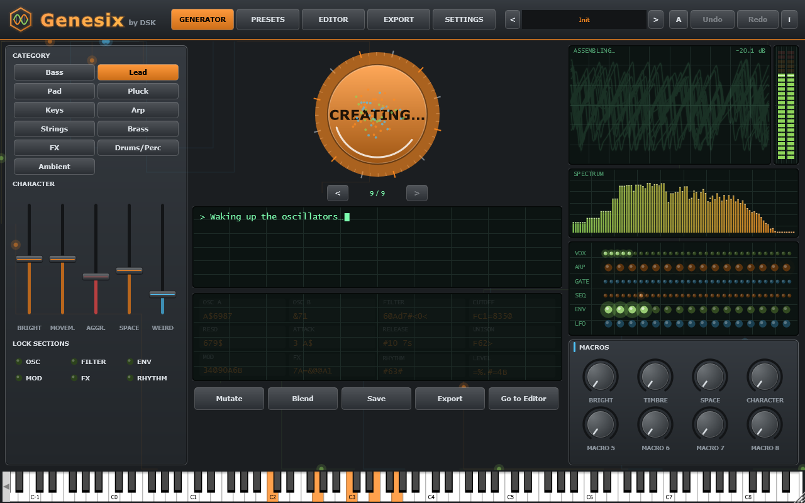
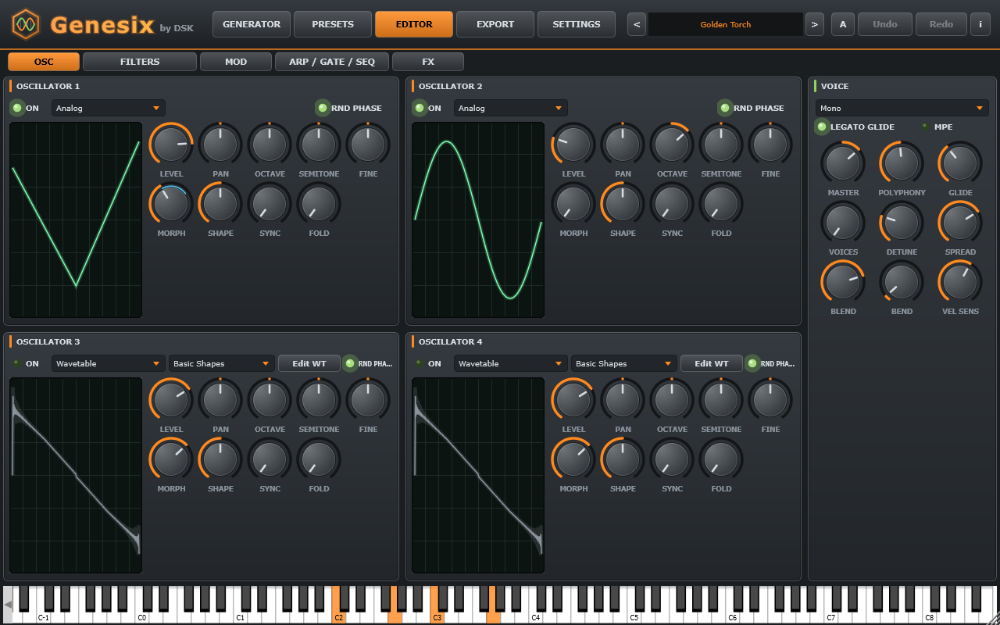
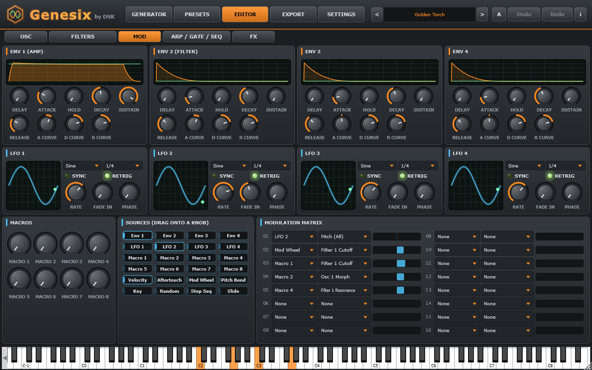
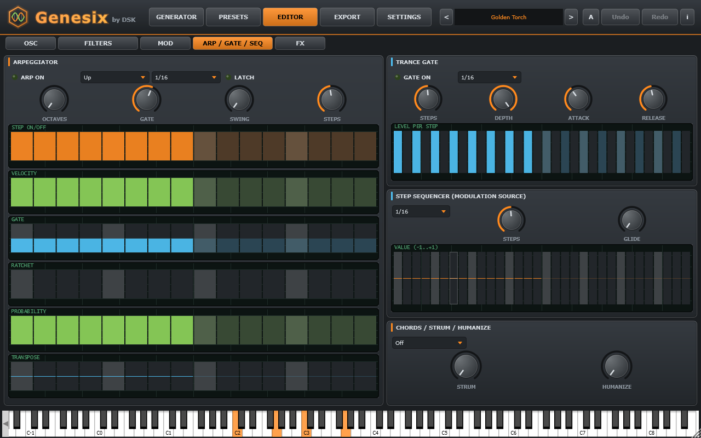
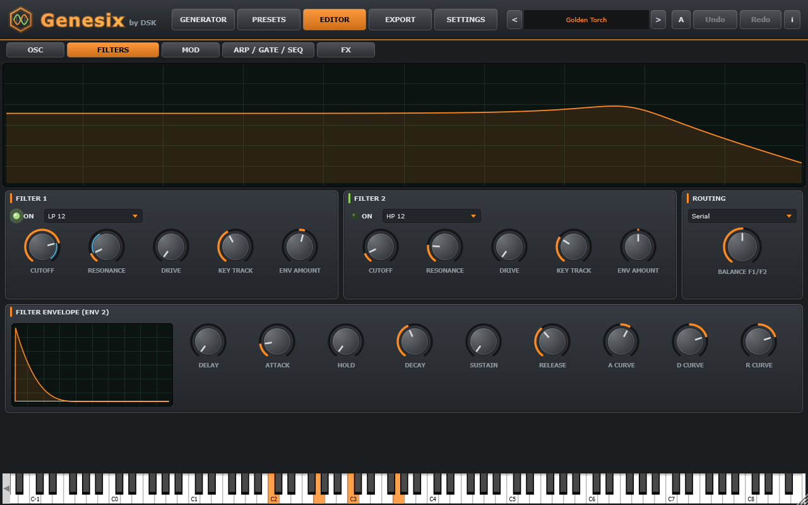
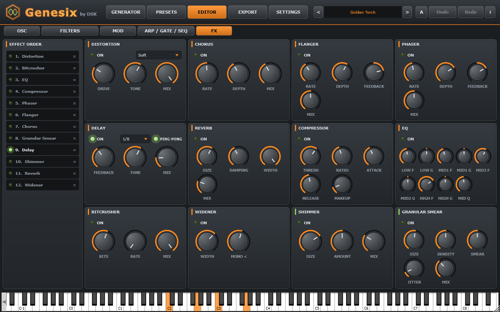
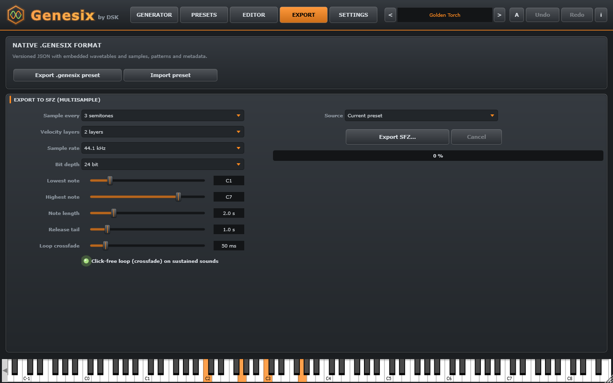
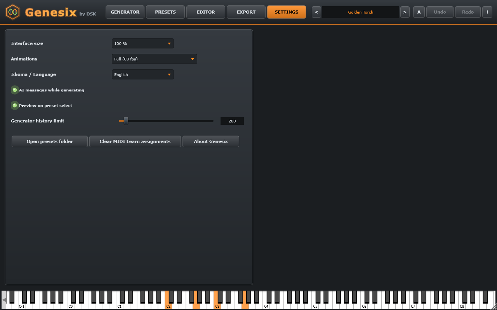

<p align="center">
  
</p>

# Genesix by DSK

[English](README.md) · **Español**

**Genesix** es un sintetizador software avanzado y gratuito (VST3, AU y Standalone) para **Windows, macOS y Linux**, de [DSK Music](https://dskmusic.com).
Su pantalla principal es un **generador inteligente de presets**: eliges categoría, ajustas el carácter con cinco sliders y pulsas **GENERAR**. Un motor basado en reglas y conocimiento musical construye el sonido, lo renderiza, lo valida y corrige su nivel. Si no supera la validación, lo descarta y crea otro. Todo en pantalla está animado y reacciona al audio. El **editor** da control total.

[](https://github.com/dskmusic/genesix-by-dsk/actions/workflows/build.yml)
[](https://github.com/dskmusic/genesix-by-dsk/releases/latest)


---

## Características

### Generador inteligente (pantalla principal)
- 11 categorías (Bass, Lead, Pad, Pluck, Keys, Arp, Strings, Brass, FX, Drums/Perc, Ambient) con más de 50 arquetipos de subcategoría.
- Sliders de **Brillo / Movimiento / Agresividad / Espacio / Rareza** que modifican los parámetros con sentido musical. No hay aleatoriedad pura:
  - el bajo lleva un sub limpio y una envolvente rápida;
  - el pad, ataque lento, unison y una reverb amplia;
  - el pluck, decay corto y brillo.
- **Validación automática** de cada sonido. Se renderiza offline y se comprueban:
  - nivel y headroom (pico ≤ −1 dBFS);
  - DC, NaN y realimentación descontrolada;
  - sustain y balance espectral (estridencia, barro, ruido).

  Si falla, se descarta y se regenera. Todos los presets de fábrica pasaron la misma validación.
- Consola de "la IA está creando tu preset": mensajes en español o inglés escritos letra a letra, más de 54 disponibles por categoría y sin repetirse seguidos. Los parámetros se "resuelven" en pantalla mientras el preset anterior se desmonta y el nuevo se ensambla.
- **Mutar** (variación suave), **Mezclar** (con el historial, un favorito o la biblioteca) y **bloqueo de secciones** (OSC, FILTRO, ENV, MOD, FX, RITMO).
- **Historial navegable** como un navegador, con botones **◀ ▶**, atajos Alt+←/→ y contador n/N. Si vuelves atrás y generas, se corta lo que había por delante. Persiste entre sesiones y su límite es configurable.
- Visualizadores en vivo a 60 fps que nunca tocan el hilo de audio:
  - osciloscopio con fósforo, analizador de espectro y vúmetros;
  - matriz de LEDs de voces, arp, gate, secuenciador, envolventes y LFOs;
  - pistas de circuito con pulsos y anillos de macros.

  En silencio hay una animación suave en reposo. Las animaciones se pueden reducir o desactivar.

### Motor de síntesis
- 32 voces, poly / mono / legato, portamento (siempre o solo en legato), unison de hasta 8 voces con detune / spread / blend, MPE y pitch bend.
- **4 osciladores**, cada uno de un tipo:
  - **Wavetable**: 24 tablas procedurales band-limited y con mip-maps, con morphing, editor espectral visual e importador de WAV.
  - **Analógico**: PolyBLEP con morph continuo seno→triángulo→sierra→cuadrada, PWM y hard sync.
  - **FM/PM**: 4 operadores, 8 algoritmos, feedback.
  - **Ruido**: blanco, rosa, marrón, crackle y digital, más un sampler.
  - **Spectral Mutation**, un oscilador original: un "genoma" armónico cuyos genes derivan y mutan lentamente entre espectros padre, así que cada voz evoluciona.
- **2 filtros** en serie o paralelo. Tipos:
  - SVF LP/HP 12/24, paso banda y notch;
  - ladder ZDF no lineal;
  - comb +/−;
  - formante (vocales).

  Cada filtro tiene drive, key tracking y cantidad de envolvente.
- **Modulación**:
  - 4 envolventes DAHDSR con curvas;
  - 4 LFOs: 8 formas, una de ellas dibujable a mano, sync al host, retrigger, fade-in y fase;
  - 8 macros;
  - una matriz de 16 slots con cantidad bipolar y 24 fuentes (envolventes, LFOs, macros, velocidad, aftertouch, mod wheel, pitch bend, nota, random, step sequencer, slide MPE) hacia unos 140 destinos. Para enrutar, se arrastra una fuente sobre un knob.
- **Ritmo y movimiento**:
  - **arpegiador**: 8 modos, rango de octavas, swing, latch, y gate, velocidad, ratchet, probabilidad y transposición por paso;
  - **trance gate**: editor de pasos, sync al host, suavizado y profundidad;
  - **step sequencer** que funciona como fuente de modulación;
  - acordes y strum, más un randomizador rítmico (humanize: velocidad aleatoria, pasos saltados y ratchets).
- **12 efectos reordenables**:
  - distorsión y waveshaper (sobremuestreo 4×), chorus, flanger, phaser;
  - delay ping-pong sincronizado, reverb FDN, compresor, EQ de 4 bandas, bitcrusher, widener (con graves en mono);
  - dos originales: **Shimmer** (desplazamiento de tono +1 octava dentro de la realimentación de la reverb) y **Granular Smear**.
- Parámetros suavizados, bloqueador de DC y protección anti-NaN. Sin asignaciones de memoria en el hilo de audio. Automatización completa.

### Presets
- Formato propio **`.genesix`**: JSON versionado con migración. Incrusta wavetables y samples, además de todos los patrones y metadatos.
- Gestor de presets al estilo Omnisphere:
  - navegación **Categoría → Subcategoría**, tags de carácter, tipo (fábrica/usuario), autor y favoritos;
  - **buscador instantáneo** por nombre, tags, categoría, autor y notas;
  - ordenación por nombre, fecha, categoría, valoración o usos; estrellas y contador de usos;
  - **previsualización al seleccionar**, navegación con ↑↓ y anterior/siguiente;
  - guardar, guardar como, renombrar, duplicar, borrar, mover y editar tags y metadatos;
  - carpetas de usuario e índice JSON para miles de presets;
  - importación y exportación de presets sueltos y de bancos `.genesixbank`.
- **Más de 200 presets de fábrica**: 20 por categoría, todos generados, validados y revisados contra duplicados. Hay presets que usan el arpegiador, el trance gate y el secuenciador.

### Editor y flujo de trabajo
- Edición total en las pestañas OSC, FILTROS, MOD, ARP/GATE/SEQ y FX.
- Visualizadores en tiempo real: formas de onda, respuesta de filtro, envolventes, LFOs dibujables y rejillas de pasos.
- Deshacer/rehacer, comparación A/B, copiar/pegar secciones enteras (clic derecho en el título de una sección) y **MIDI learn** (clic derecho en cualquier knob).

### Exportación
- **Exportación a SFZ**: renderiza el preset a WAV (16/24 bit, 44,1/48 kHz). Opciones:
  - muestrear cada N semitonos, con 1–8 capas de velocidad;
  - duración de nota y cola de release;
  - **loops sin clicks con crossfade**, alineados a periodos completos.

  El resultado es una carpeta con el `.sfz` (opcodes `lokey/hikey/pitch_keycenter/lovel/hivel`, ADSR, filtro y loop) y `samples/*.wav`, compatible con sfizz. El progreso se puede cancelar sin bloquear la UI, se exporta por lotes y avisa de las modulaciones que el SFZ no puede representar.

### Diseño
- Aspecto propio inspirado en FL Studio: tema gris carbón, acentos naranja y verde, paneles biselados, knobs con aro de valor y de modulación, y tooltips con valor.
- Interfaz vectorial **redimensionable y escalable del 50 % al 200 %**. Todo el aspecto se define en un único módulo de tema.
- **Interfaz en inglés y en español**: se elige sola según el idioma del sistema en el primer arranque y se puede cambiar en Ajustes.

## Capturas

| Generador | Gestor de presets |
|---|---|
|  |  |
| **Generando** | **Editor: osciladores** |
|  |  |
| **Editor: modulación** | **Editor: arp / gate / secuenciador** |
|  |  |
| **Editor: filtros** | **Editor: FX** |
|  |  |
| **Exportar (SFZ)** | **Ajustes** |
|  |  |

## Instalación

Descarga la última versión en **[Releases](https://github.com/dskmusic/genesix-by-dsk/releases/latest)**.

| SO | Archivos | Instalación |
|---|---|---|
| **Windows x64** | `…-win-x64-setup.exe` (instalador) o `…-win-x64-vst3.zip` / `…-standalone.zip` | Ejecuta el instalador, o copia `Genesix by DSK.vst3` a `C:\Program Files\Common Files\VST3\` |
| **macOS (Universal)** | `…-macos-universal-installer.pkg` o `…-vst3.zip`, `…-au.zip`, `…-standalone.zip` | Ejecuta el pkg, o copia a `~/Library/Audio/Plug-Ins/VST3` / `Components`. Los binarios no están notarizados: clic derecho → Abrir, o `xattr -dr com.apple.quarantine <ruta>` |
| **Linux x86_64** | `…-linux-x64-vst3.tar.gz`, `…-standalone.tar.gz` | Descomprime `Genesix by DSK.vst3` en `~/.vst3/` |

Verifica las descargas con `SHA256SUMS.txt`. Presets, historial y ajustes se guardan en `Documentos/DSK Music/Genesix/`.

## Uso rápido
1. Abre **GENERADOR**, elige una categoría, ajusta los sliders y pulsa **GENERAR** (Ctrl+Intro).
2. Toca con el teclado en pantalla o tu controlador MIDI. Usa **◀ ▶** para recorrer lo generado.
3. **Mutar** crea variaciones. Bloquea las secciones que te gusten y **Guardar** lleva el sonido a la biblioteca.
4. **Pasar a Editor** para controlarlo todo, o **EXPORTAR** a `.genesix` o SFZ.

## Compilar desde el código

Requisitos: CMake ≥ 3.22, un compilador C++20 (MSVC 2022, Xcode 15+, GCC 11+/Clang 14+), Ninja y Python 3. En Linux, además, las dependencias de JUCE:

```bash
sudo apt-get install build-essential cmake ninja-build libasound2-dev libx11-dev libxcomposite-dev libxcursor-dev \
  libxext-dev libxinerama-dev libxrandr-dev libxrender-dev libfreetype-dev libfontconfig1-dev libgl1-mesa-dev
```

```bash
# Windows (desde la carpeta del repo; carga solo el entorno de MSVC)
build_local.bat Release            # añade "package" para generar dist/ con zips e instalador
# macOS / Linux
./build_local.sh Release           # añade "package" para generar dist/
```

JUCE 8 se descarga automáticamente, o puedes ponerlo en `third_party/JUCE` para compilar sin red. Tests: `build/GenesixTool_artefacts/Release/GenesixTool test`. Validador: [pluginval](https://github.com/Tracktion/pluginval) con nivel de exigencia 10.

### CI / CD
- `.github/workflows/build.yml` se ejecuta en cada push y PR. Compila en Windows (MSVC), macOS (universal) y Ubuntu, pasa los tests unitarios, **pluginval nivel 10** y **auval** en macOS, y sube artefactos por plataforma.
- `.github/workflows/release.yml` se activa con un tag `vX.Y.Z`. Compila todo y publica una Release de GitHub con zips y tar.gz, el instalador de Windows, el pkg de macOS y `SHA256SUMS.txt`.

## Estructura del proyecto

```
src/
  Params.*            tabla única de parámetros (IDs, rangos, destinos de modulación)
  PluginProcessor.*   plugin, estado (JSON), MIDI learn, datos del osciloscopio
  PluginEditor.*      contenedor escalable del editor
  dsp/                motor, voces, osciladores, wavetables, filtros, envolventes/LFOs, ritmo, FX
  preset/             formato .genesix, biblioteca/índice, render offline
  gen/                generador por reglas + validación, mensajes de la IA, historial
  sfz/                exportador SFZ
  ui/                 tema/LookAndFeel, widgets, visualizadores, páginas
tests/                GenesixTool: tests, benchmark, informes del generador, banco de fábrica, capturas
resources/            factory.genesixbank (incrustado)
scripts/              utilidades de empaquetado
installer/            script de Inno Setup
```

Las decisiones de diseño están en [DECISIONS.md](DECISIONS.md) y los cambios en [CHANGELOG.md](CHANGELOG.md).

## Licencia y créditos

Genesix by DSK es **software libre** bajo **GNU GPL v3** ([LICENSE](LICENSE)).
Construido con [JUCE](https://juce.com) (GPLv3) y el VST3 SDK de Steinberg (MIT). VST es una marca de Steinberg Media Technologies GmbH.

Diseño, motor de sonido y presets: **DSK Music** · **[dskmusic.com](https://dskmusic.com)**
