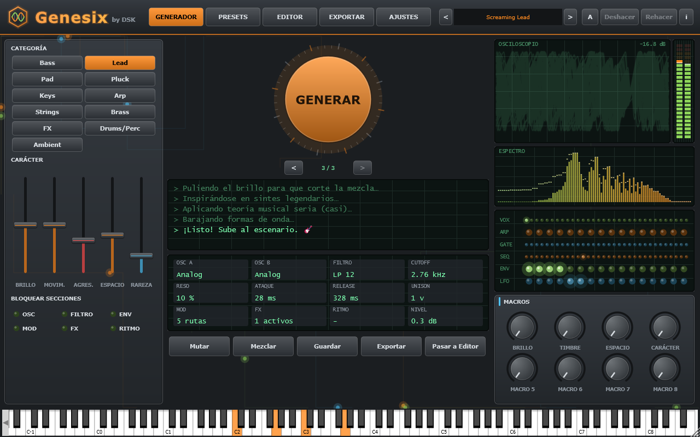
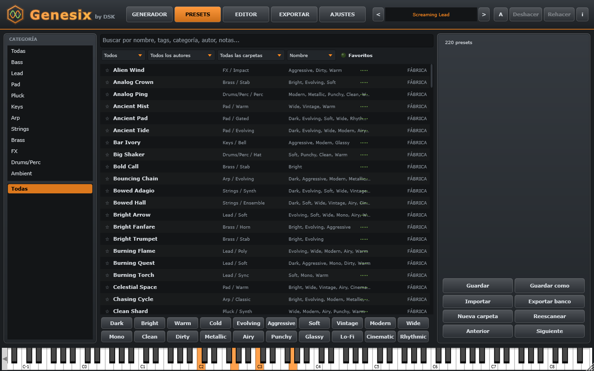
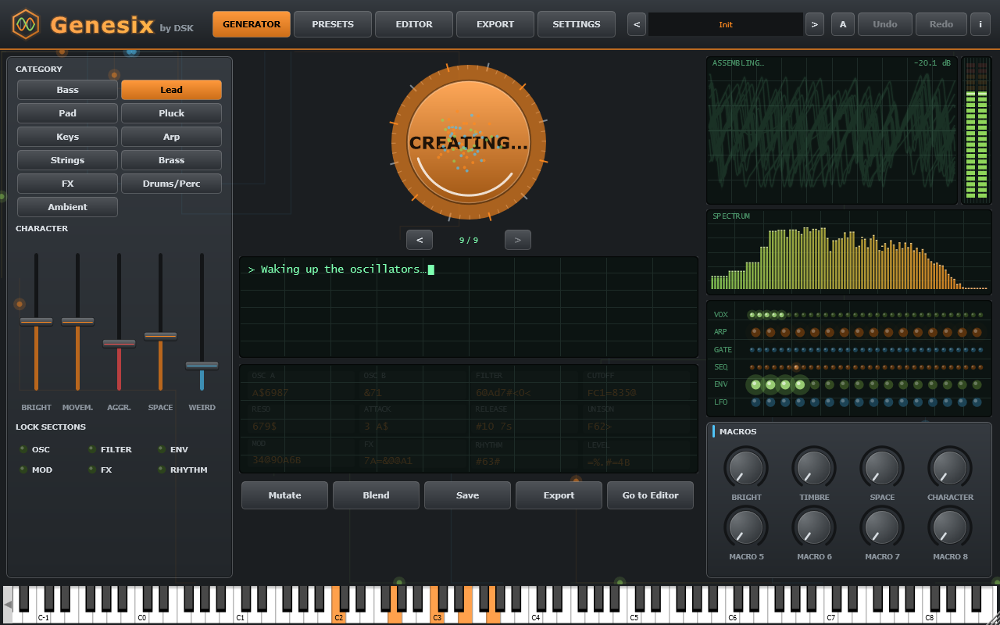
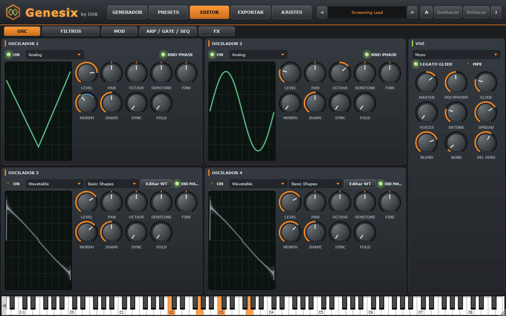
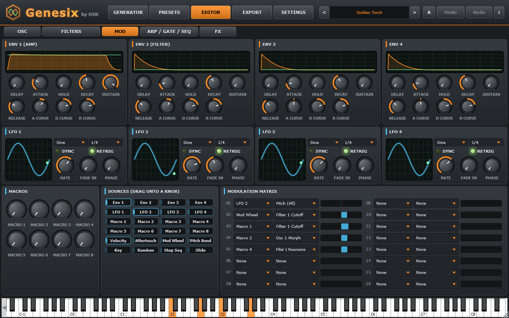
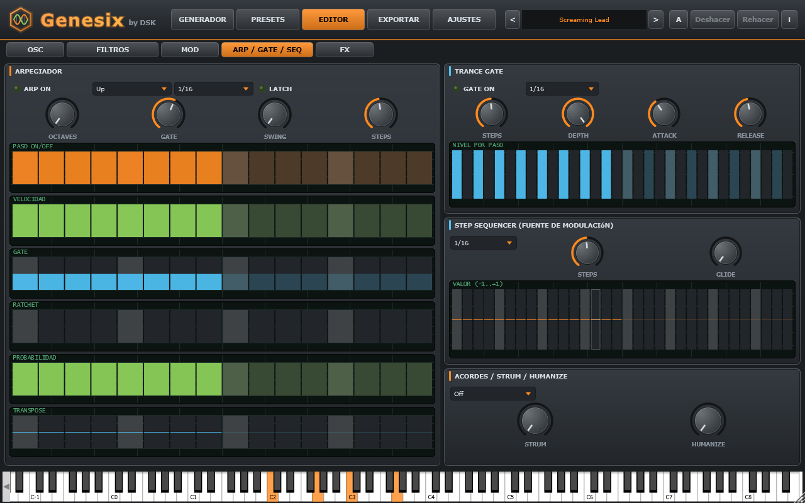
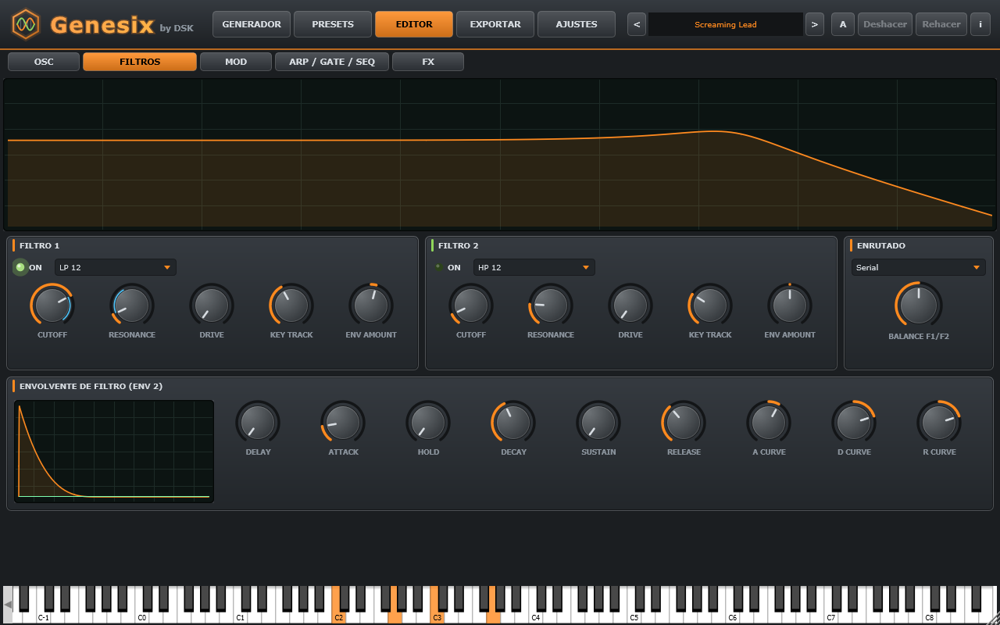
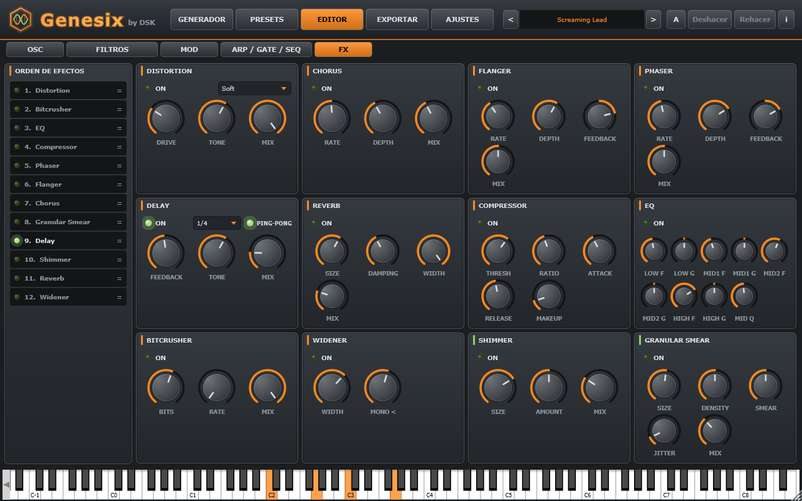
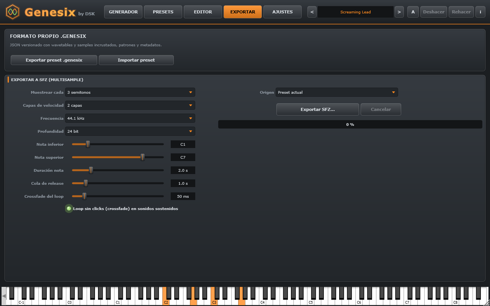
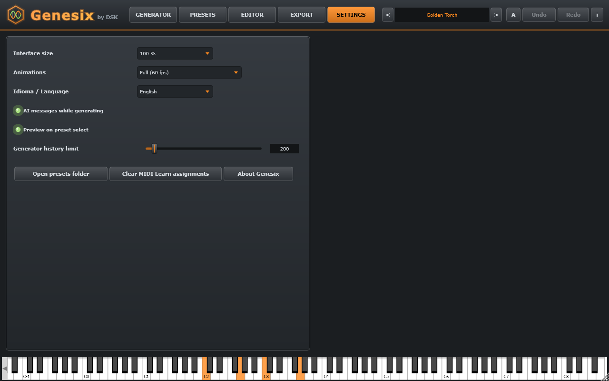

<p align="center">
  
</p>

# Genesix by DSK

**English** · [Español](README.es.md)

**Genesix** is a free, advanced software synthesizer (VST3, AU and Standalone) for **Windows, macOS and Linux** by [DSK Music](https://dskmusic.com).
Its main screen is a **smart preset generator**: pick a category, shape the character with five sliders, press **GENERATE**. A rule-based engine with real musical knowledge builds the sound, renders it offline, checks it and fixes its level. If it fails the checks, it builds another one. Every element on screen is animated and reacts to the audio. The full **editor** gives you total control.

[](https://github.com/dskmusic/genesix-by-dsk/actions/workflows/build.yml)
[](https://github.com/dskmusic/genesix-by-dsk/releases/latest)
[](https://github.com/dskmusic/genesix-by-dsk/releases)


---

## Features

### Smart generator (main screen)
- 11 categories (Bass, Lead, Pad, Pluck, Keys, Arp, Strings, Brass, FX, Drums/Perc, Ambient) with 50+ sub-category archetypes.
- **Brightness / Movement / Aggression / Space / Weirdness** sliders that change parameters in musically meaningful ways. Generation follows rules, not dice rolls:
  - bass gets a clean sub and a fast envelope;
  - pads get slow attacks, unison and a wide reverb;
  - plucks get a short decay and plenty of brightness.
- **Automatic validation** of every generated sound. Each one is rendered offline and checked for:
  - level and headroom (peak ≤ −1 dBFS);
  - DC offset, NaN and runaway feedback;
  - sustain and spectral balance (harshness, mud, noise).

  A sound that fails is discarded and regenerated. Every factory preset went through the same validation.
- "The AI is creating your preset" console: typewriter messages in Spanish or English, 54+ lines available per category, never repeated back to back. Parameter values resolve on screen while the old patch is taken apart and the new one is assembled.
- **Mutate** (gentle variation), **Blend** (with history, favourites or library), **section locks** (OSC, FILTER, ENV, MOD, FX, RHYTHM).
- **Browser-like history** with **◀ ▶** buttons, Alt+←/→ shortcuts and an n/N counter. Generating after going back cuts the forward branch. It keeps only the current session (it starts empty each time the plugin loads) and its limit is configurable.
- Live displays at 60 fps that never touch the audio thread:
  - phosphor oscilloscope, spectrum analyser and VU meters;
  - LED matrix for voices, arp, gate, sequencer, envelopes and LFOs;
  - circuit traces with pulses, and macro rings.

  In silence a gentle idle animation keeps running. Animation can be reduced or turned off.

### Synth engine
- 32 voices, poly / mono / legato, portamento (always or legato only), unison up to 8 with detune / spread / blend, MPE and pitch bend.
- **4 oscillators**, each one of:
  - **Wavetable**: 24 procedural, band-limited, mip-mapped tables with morphing, plus a visual spectral editor and a WAV importer.
  - **Analog**: PolyBLEP with continuous sine→triangle→saw→square morph, PWM and hard sync.
  - **FM/PM**: 4 operators, 8 algorithms, feedback.
  - **Noise**: white, pink, brown, crackle and digital, plus a sampler.
  - **Spectral Mutation**, an original oscillator: a harmonic "genome" whose genes slowly drift and mutate between parent spectra, so every voice keeps evolving.
- **2 filters** in series or parallel. Types:
  - SVF LP/HP 12/24, band-pass and notch;
  - nonlinear ZDF ladder;
  - comb +/−;
  - formant (vowels).

  Each filter has drive, key tracking and envelope amount.
- **Modulation**:
  - 4 DAHDSR envelopes with curves;
  - 4 LFOs: 8 shapes including a hand-drawn one, host sync, retrigger, fade-in and phase;
  - 8 macros;
  - a 16-slot matrix with bipolar amounts and 24 sources (envelopes, LFOs, macros, velocity, aftertouch, mod wheel, pitch bend, key, random, step sequencer, MPE slide) across ~140 destinations. Drag a source chip onto a knob to route it.
- **Rhythm and motion**:
  - **arpeggiator**: 8 modes, octave range, swing, latch, and per-step gate, velocity, ratchet, probability and transpose;
  - **trance gate**: step editor, host sync, smoothing and depth;
  - **step sequencer** usable as a modulation source;
  - chord and strum, plus a rhythmic randomizer (humanize: random velocity, skipped steps and ratchets).
- **12 re-orderable FX**:
  - distortion and waveshaper (4× oversampled), chorus, flanger, phaser;
  - tempo-synced ping-pong delay, FDN reverb, compressor, 4-band EQ, bitcrusher, widener (bass mono);
  - two originals: **Shimmer** (octave-up pitch shifting in the reverb's feedback loop) and **Granular Smear**.
- Smoothed parameters, a DC blocker and NaN protection. The audio thread never allocates. Full automation.

### Presets
- Own **`.genesix`** format: versioned JSON with a migration hook. Wavetables and samples are embedded, along with all patterns and metadata.
- Preset manager in the Omnisphere style:
  - **Category → Sub-category** browser, character tags, factory/user type, author and favourites;
  - **instant search** over name, tags, category, author and notes;
  - sort by name, date, category, rating or uses; star ratings and use counter;
  - **preview on select**, plus ↑↓ and previous/next navigation;
  - save, save as, rename, duplicate, delete, move, and edit tags and metadata;
  - user folders and a JSON index that scales to thousands of presets;
  - import and export of single presets and `.genesixbank` banks.
- **200+ factory presets**: 20 per category, every one generated, validated and checked for duplicates. They include presets that use the arpeggiator, the trance gate and the step sequencer.

### Editor and workflow
- Full editing across the OSC, FILTERS, MOD, ARP/GATE/SEQ and FX tabs.
- Real-time displays: waveforms, filter response, envelopes, drawable LFOs and step grids.
- Undo/redo, A/B comparison, copy/paste of whole sections (right-click a section title) and **MIDI learn** (right-click any knob).

### Export
- **SFZ export** renders the preset offline to WAV (16/24-bit, 44.1/48 kHz). Options:
  - sample every N semitones, with 1–8 velocity layers;
  - set note length and release tail;
  - **click-free crossfaded loops**, aligned to whole periods.

  The output is a folder with an `.sfz` file (`lokey/hikey/pitch_keycenter/lovel/hivel`, ADSR, filter and loop opcodes) and `samples/*.wav`, compatible with sfizz. Progress can be cancelled without blocking the UI, presets can be exported in batches, and the exporter warns about modulation that SFZ cannot represent.

### Design
- Custom FL-Studio-inspired look: charcoal theme, orange and green accents, bevelled panels, knobs with value and modulation rings, and value tooltips.
- Vector UI, **resizable and scalable from 50% to 200%**. The whole look lives in one theme module.
- **English and Spanish interface**: picked automatically from the system language on first run, switchable in Settings.

## Screenshots

| Generator | Preset manager |
|---|---|
|  |  |
| **Generating** | **Editor: oscillators** |
|  |  |
| **Editor: modulation** | **Editor: arp / gate / sequencer** |
|  |  |
| **Editor: filters** | **Editor: FX** |
|  |  |
| **Export (SFZ)** | **Settings** |
|  |  |

## Installation

Download the latest build from **[Releases](https://github.com/dskmusic/genesix-by-dsk/releases/latest)**.

| OS | Files | Install |
|---|---|---|
| **Windows x64** | `…-win-x64-setup.exe` (installer) or `…-win-x64-vst3.zip` / `…-standalone.zip` | Run the installer, or copy `Genesix by DSK.vst3` to `C:\Program Files\Common Files\VST3\` |
| **macOS (Universal)** | `…-macos-universal-installer.pkg` or `…-vst3.zip`, `…-au.zip`, `…-standalone.zip` | Run the pkg, or copy to `~/Library/Audio/Plug-Ins/VST3` / `Components`. The binaries are not notarized: right-click → Open, or `xattr -dr com.apple.quarantine <path>` |
| **Linux x86_64** | `…-linux-x64-vst3.tar.gz`, `…-standalone.tar.gz` | Extract `Genesix by DSK.vst3` into `~/.vst3/` |

Verify downloads with `SHA256SUMS.txt`. Presets and settings are stored in `Documents/DSK Music/Genesix/`.

## Quick start
1. Open **GENERATOR**, choose a category, set the sliders and press **GENERATE** (Ctrl+Enter).
2. Play the on-screen keyboard or your MIDI controller. Use **◀ ▶** to walk through what you generated.
3. **Mutate** for variations, lock sections you like, and **Save** to keep a sound in the library.
4. **Go to Editor** for full control, or **EXPORT** to `.genesix` or SFZ.

## Building from source

Requirements: CMake ≥ 3.22, a C++20 compiler (MSVC 2022, Xcode 15+, GCC 11+/Clang 14+), Ninja and Python 3. On Linux you also need the JUCE dependencies:

```bash
sudo apt-get install build-essential cmake ninja-build libasound2-dev libx11-dev libxcomposite-dev libxcursor-dev \
  libxext-dev libxinerama-dev libxrandr-dev libxrender-dev libfreetype-dev libfontconfig1-dev libgl1-mesa-dev
```

```bash
# Windows (from the repo folder; loads the MSVC environment automatically)
build_local.bat Release            # add "package" to create dist/ zips + installer
# macOS / Linux
./build_local.sh Release           # add "package" to create dist/ archives
```

JUCE 8 is fetched automatically, or placed in `third_party/JUCE` to build offline. Tests: `build/GenesixTool_artefacts/Release/GenesixTool test`. Validator: [pluginval](https://github.com/Tracktion/pluginval) at strictness 10.

### CI / CD
- `.github/workflows/build.yml` runs on every push and PR. It builds on Windows (MSVC), macOS (universal) and Ubuntu, then runs unit tests, **pluginval at strictness 10** and **auval** on macOS, and uploads per-platform artifacts.
- `.github/workflows/release.yml` triggers on a `vX.Y.Z` tag. It builds everything and publishes a GitHub Release with zips and tarballs, the Windows installer, the macOS pkg and `SHA256SUMS.txt`.

## Project structure

```
src/
  Params.*            single parameter table (IDs, ranges, modulation destinations)
  PluginProcessor.*   plugin, state (JSON), MIDI learn, scope feed
  PluginEditor.*      scalable editor shell
  dsp/                engine, voices, oscillators, wavetables, filters, envelopes/LFOs, rhythm, FX
  preset/             .genesix format, library/index, offline renderer
  gen/                rule-based generator + validation, AI messages, history
  sfz/                SFZ exporter
  ui/                 theme/LookAndFeel, widgets, visualisers, pages
tests/                GenesixTool: unit tests, benchmark, generator reports, factory builder, screenshots
resources/            factory.genesixbank (embedded)
scripts/              packaging helpers
installer/            Inno Setup script
```

Design decisions are recorded in [DECISIONS.md](DECISIONS.md), and changes in [CHANGELOG.md](CHANGELOG.md).

## License and credits

Genesix by DSK is **free software** under the **GNU GPL v3** ([LICENSE](LICENSE)).
Built with [JUCE](https://juce.com) (GPLv3) and the Steinberg VST3 SDK (MIT). VST is a trademark of Steinberg Media Technologies GmbH.

Design, sound engine and presets: **DSK Music** · **[dskmusic.com](https://dskmusic.com)**
